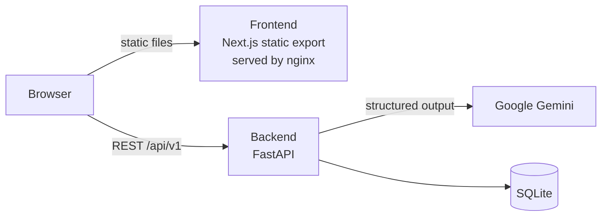

# Cookable

[](https://github.com/eylulseyit/Cookable/actions/workflows/ci.yml)
[](LICENSE)

Cookable turns the ingredients you already have into a recipe. Enter what's in your kitchen, pick optional filters, and Google Gemini generates a complete recipe, plus a shopping list if you allow a few extra ingredients.

## Features

- **Ingredient-based recipes**: add ingredients one by one or from quick-add suggestions
- **Filters**: dietary preferences (vegetarian, vegan, gluten-free, ...) and a maximum cooking time
- **Shopping list**: when extra ingredients are allowed, a second step compares the recipe with what you have and lists what to buy
- **Reliable AI output**: recipes are generated with LangChain structured output, so Gemini's response is validated against a Pydantic schema instead of parsed by hand
- **Graceful failure handling**: clear 422 / 502 / 503 errors, and the recipe is still returned if only the shopping list step fails

## Tech Stack

| Layer | Technologies |
|---|---|
| Frontend | Next.js 15 (static export), React 19, TypeScript, Tailwind CSS 4 |
| Backend | Python 3.12, FastAPI, Pydantic, SQLAlchemy, SQLite |
| AI | Google Gemini (`gemini-2.5-flash`) via LangChain |
| Testing | pytest with a fake LLM (no API key or network needed) |
| Tooling | pnpm, Docker / Podman, Docker Compose, GitHub Actions |

## Architecture



The frontend is a fully client-side Next.js app exported to static files, so it can be served by any static host. All AI work happens in the FastAPI backend, which keeps the API key on the server.

## Quick Start (Docker / Podman)

**Prerequisites:** Docker or Podman with Compose, and a free [Gemini API key](https://aistudio.google.com/apikey).

```bash
git clone https://github.com/eylulseyit/Cookable.git
cd Cookable

cp backend/.env.example backend/.env
# Open backend/.env and set GOOGLE_API_KEY

docker compose up --build        # or: podman compose up --build
```

- App: http://localhost:3000
- API docs (Swagger UI): http://localhost:8000/docs

Stop with `Ctrl+C`, then `docker compose down`. Recipe data is kept in a named volume between runs.

## Local Development

Run the backend and frontend in two terminals for hot reload.

**Backend** (Python 3.12+):

```bash
cd backend
python -m venv .venv
source .venv/bin/activate        # Windows: .venv\Scripts\activate
pip install -r requirements-dev.txt
cp .env.example .env             # then set GOOGLE_API_KEY
uvicorn main:app --reload
```

Optionally seed the database with sample ingredients and tags: `python init_db.py`.

**Frontend** (Node.js 22+, pnpm):

```bash
cd frontend
pnpm install
pnpm dev
```

The frontend calls `http://localhost:8000/api/v1` by default. Set `NEXT_PUBLIC_API_URL` (see `frontend/.env.example`) to point it elsewhere.

## Configuration

Backend settings are read from environment variables or `backend/.env`:

| Variable | Default | Description |
|---|---|---|
| `GOOGLE_API_KEY` | (required) | Gemini API key |
| `GEMINI_MODEL` | `gemini-2.5-flash` | Gemini model used for generation |
| `DATABASE_URL` | `sqlite:///backend/cookable.db` | SQLAlchemy database URL |
| `CORS_ORIGINS` | `http://localhost:3000,http://127.0.0.1:3000` | Comma-separated allowed origins |

> The Gemini free tier is rate-limited (a few requests per minute for `gemini-2.5-flash`). If you hit the limit, the API returns an error and you can retry after a minute.

## API

| Method | Endpoint | Description |
|---|---|---|
| `POST` | `/api/v1/recipes/recommend` | Generate a recipe from ingredients and filters |
| `GET` | `/api/v1/ingredients/suggestions?query=` | Ingredient suggestions based on past usage |
| `GET` | `/api/v1/ingredients/popular` | Most frequently used ingredients |
| `GET` | `/health` | Health check |

Example request:

```bash
curl -X POST http://localhost:8000/api/v1/recipes/recommend \
  -H "Content-Type: application/json" \
  -d '{"ingredients": ["egg", "tomato", "onion"], "allow_external_ingredients": true}'
```

Full, interactive documentation is available at `/docs` while the backend is running.

## Testing and CI

```bash
cd backend
pytest
```

The tests replace Gemini with a fake model through FastAPI dependency overrides, so they run offline in well under a second and need no API key.

GitHub Actions runs on every push to `dev` and `main` and on pull requests:

- **Backend**: pytest
- **Frontend**: ESLint, TypeScript type check, production build
- **Containers**: builds both images with Docker Compose

## Project Structure

```
Cookable/
├── backend/
│   ├── app/
│   │   ├── api/          # FastAPI routes
│   │   ├── core/         # Settings and database setup
│   │   ├── models/       # Pydantic schemas and SQLAlchemy models
│   │   └── services/     # Recipe generation and database logic
│   ├── tests/            # pytest suite with a fake LLM
│   ├── main.py           # FastAPI application entry point
│   └── Dockerfile
├── frontend/
│   ├── src/
│   │   ├── app/          # Next.js App Router pages
│   │   ├── components/   # React components
│   │   ├── services/     # API client
│   │   └── types/        # TypeScript types
│   └── Dockerfile
├── compose.yaml
└── .github/workflows/    # CI pipeline
```

## License

Cookable is licensed under the [GNU Affero General Public License v3.0 or later](LICENSE).
